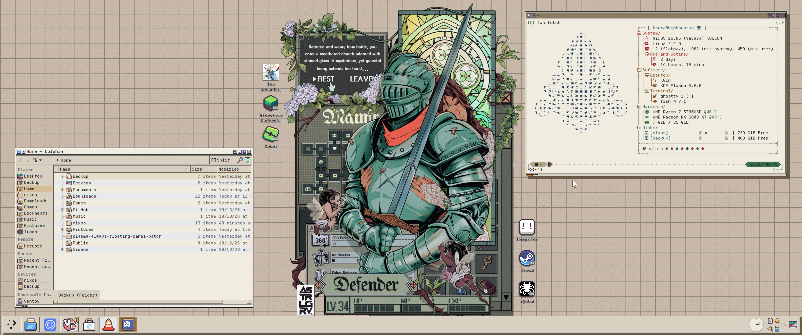
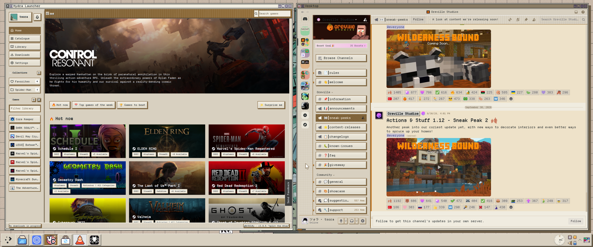

# My NixOS config

My personal NixOS desktop config - heavily assisted by AI on the things I'm still learning. A setup of **KDE Plasma + a cream-brown pixel art aesthetic**.

It runs NixOS 26.05 with **Home Manager** for user settings and **Plasma Manager** for KDE configuration.

This is tailored to my hardware and preferences, but the modules should
make it fairly easy to find something you want to borrow.

## Screenshots
<h3 align="center">🖥️ Plasma Overdose Cream</h3>
<p align="center">
  
</p>
<h3 align="center">🐉 Hydra Launcher + Discord</h3>
<p align="center">
  
</p>

## How everything works:
- [NixOS](docs/NIXOS.md)
- [Home Manager](docs/HOME-MANAGER.md)
- [Plasma Manager](docs/PLASMA-MANAGER.md)

There are three main layers:

| Layer | What it handles |
| --- | --- |
| NixOS | Hardware, boot, users, networking, system services and packages |
| Home Manager | My applications, shell, dotfiles and files in my home directory |
| Plasma Manager | KDE preferences, shortcuts, window rules and wallpaper settings |

[`flake.nix`](flake.nix) brings those layers together. It defines the `hephaestus`
system and its dependencies; `flake.lock` records their exact revisions.

The main package set follows NixOS 26.05. Zen Browser uses the separate
unstable input, while other inputs provide: 
- `home-manager`;
- `plasma-manager`; 
- `nix-flatpak` (for declarative flatpak managing); 
- `millennium` (for Steam ricing); 
- `qylock` (for the awesome `sddm` screens); 

## Validate and apply

From the repository root:

```sh
# Evaluate the configuration without building the whole system
nix flake check --no-build --no-write-lock-file

# Build Tidaler and run its packaging checks
nix build --no-link --no-write-lock-file .#tidaler
```

The GitHub Actions workflow runs these checks too.

To try and then persist the system configuration:

```sh
sudo nixos-rebuild test --flake .#hephaestus
sudo nixos-rebuild switch --flake .#hephaestus
```

`test` activates the configuration without making it the boot default.
`switch` also makes it the default for subsequent boots.

If you’re adapting this setup, review the hardware configuration,
username, home paths, monitor-specific settings and SSH identity first.

Leave `system.stateVersion` and `home.stateVersion` alone during
routine updates: they control compatibility defaults, not package versions.

## Credits

This setup uses and builds on:

- [NixOS](https://nixos.org/), [Home Manager](https://github.com/nix-community/home-manager) and [Plasma Manager](https://github.com/nix-community/plasma-manager)
- [KDE Plasma](https://kde.org/pt-br/plasma-desktop/) and [Karousel](https://github.com/peterfajdiga/karousel)
- [Pixora icons](https://github.com/tsora1603/pixora-icons) (my icon theme!)
- [Plasma Overdose](https://github.com/Notify-ctrl/Plasma-Overdose) by Notify-ctrl (the base for the local KDE theme)
- [Millennium](https://github.com/SteamClientHomebrew/Millennium) and ricewind012’s [Win95 Steam theme](https://github.com/ricewind012/win95-themes/blob/master/docs/steam.md)
- [Qylock](https://github.com/Darkkal44/qylock)
- [plasma-always-floating-panel-patch](https://github.com/illatillmods/plasma-always-floating-panel-patch)
